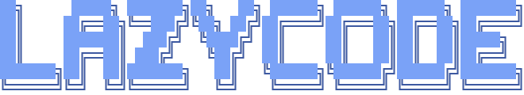

<p align="center">
  
</p>

<p align="center">
  <strong>The power and look of LazyVim, with the mouse and shortcuts you know from VS Code.</strong>
</p>

<p align="center">
  <a href="https://github.com/pimpoknot/lazycode/actions/workflows/ci.yml"></a>
  <a href="LICENSE"></a>
  
  
</p>

> **Status: release candidate.** Linux is tested. macOS support is being validated.

## Install

```sh
curl -fsSL https://raw.githubusercontent.com/pimpoknot/lazycode/main/install.sh | sh
```

The installer needs `curl`, `tar`, `git` and, on Linux, `xz`. A C compiler is recommended for
syntax highlighting. It does not use `sudo` and does not touch your Neovim or kitty setup.
Neovim, kitty, lazygit, ripgrep, fd and Node are downloaded at pinned versions, verified with
SHA-256 and kept in `~/.local/share/lazycode-runtime`.

A full install uses about 1.2 GB, most of it language servers. To skip them:

```sh
curl -fsSL https://raw.githubusercontent.com/pimpoknot/lazycode/main/install.sh | LAZYCODE_SKIP_TOOLS=1 sh
```

A Homebrew formula is planned for the first stable release.

## Use

```sh
lazycode              # Welcome screen
lazycode .            # open a folder as a project
lazycode file.py      # open a file
lazycode doctor       # check the installation
lazycode update       # update
lazycode uninstall    # remove LazyCode
```

You can also open **LazyCode** from your app launcher (Linux) or `~/Applications` (macOS).

## Features

- Welcome screen with New File, Open File, Open Folder, Clone Repository and recent projects
- Always ready to type, with selections that are replaced as you type
- Full mouse support: click, drag, double click, context menus, tabs and multiple cursors
- Explorer with create, rename, copy, cut, paste and delete to trash
- Source Control sidebar powered by lazygit
- Integrated terminal with mouse selection, copy and paste
- Completion for TypeScript, JavaScript, Python, JSON, YAML, TOML, Markdown, Docker, Tailwind,
  HTML, CSS, Bash and Lua out of the box
- Other languages on demand: `:LazyCodeLanguage go`
- Vim is one shortcut away: `Ctrl+Alt+V`, or click `CODE` in the status bar

## Shortcuts

On macOS, use `Cmd` in place of `Ctrl`, except for `` Ctrl+` ``, `Ctrl+Tab` and `Ctrl+J`.

| Area | Shortcuts |
| --- | --- |
| Files | `Ctrl+N` new, `Ctrl+O` open, `Ctrl+K Ctrl+O` open folder, `Ctrl+S` save, `Ctrl+W` close |
| Editing | `Ctrl+Z`, `Ctrl+Y`, `Ctrl+C`, `Ctrl+X`, `Ctrl+V`, `Ctrl+A`, `Ctrl+/` |
| Lines | `Alt+Up/Down` move, `Shift+Alt+Up/Down` duplicate, `Ctrl+Shift+K` delete |
| Cursors | `Ctrl+D`, `Ctrl+Shift+L`, `Ctrl+Alt+Up/Down`, `Alt+Click` |
| Navigate | `Ctrl+P`, `Ctrl+Shift+P`, `Ctrl+G`, `F12`, `Shift+F12`, `Alt+Left/Right` |
| Search | `Ctrl+F`, `Ctrl+H`, `Ctrl+Shift+F`, `Ctrl+Shift+H` |
| Code | `Ctrl+Space`, `Ctrl+.`, `F2`, `Shift+Alt+F`, `F8` |
| Panels | `Ctrl+B`, `Ctrl+Shift+E`, `Ctrl+Shift+G`, `` Ctrl+` ``, `Ctrl+Shift+M` |
| Terminal | `Ctrl+Shift+C` copy, `Ctrl+Shift+V` paste |
| Help | `Ctrl+K Ctrl+S` lists every shortcut |

## Customize

- Window look: `~/.config/lazycode.local/kitty.conf`
- More languages and plugins: `:LazyExtras`

## Known limitations

- VS Code extensions do not run. Languages and tools come from the Neovim ecosystem.
- No debugger panel, Remote/SSH, or tab dragging yet.
- `Ctrl+Shift+L` selects the matches visible on screen.
- Windows is not supported.

## Uninstall

```sh
lazycode uninstall
```

It asks before deleting your settings, plugins and language tools.

## Contributing

See [CONTRIBUTING.md](CONTRIBUTING.md). Run the test suites with `tests/headless.sh`.

## Credits and license

LazyCode is an independent project. It is not affiliated with or endorsed by LazyVim, Neovim or
Microsoft. Visual Studio Code is a trademark of Microsoft.

Licensed under [Apache-2.0](LICENSE). See [NOTICE](NOTICE) for third-party credits.
